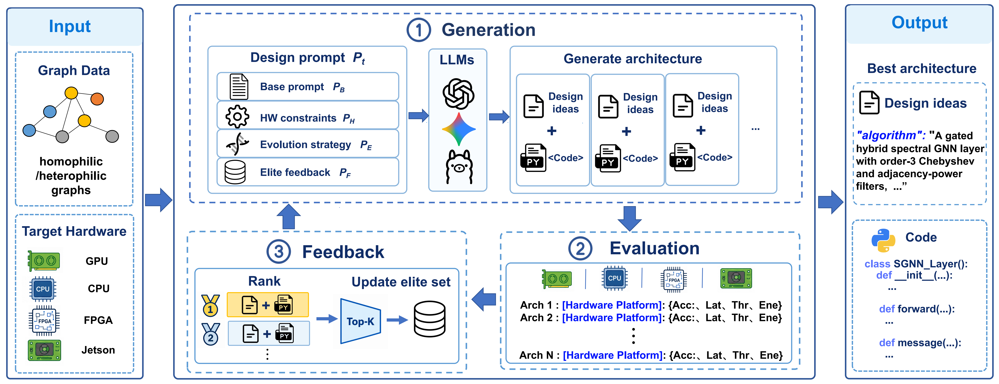

[README.md](https://github.com/user-attachments/files/34130028/README.md)
# LLM-HSGNAS

## Overview

Code for **Large Language Models for Hardware-aware Spectral Graph Neural Architecture Search**.

LLM-HSGNAS uses a large language model to generate spectral graph neural network architectures for edge devices. It combines spectral priors and deployment constraints with evolutionary search, using predictive accuracy, inference latency, throughput, energy consumption, and deployment feedback to refine candidate architectures.




## Requirements

- Python 3.10, PyTorch 2.1.2 with CUDA 11.8, and PyTorch Geometric 2.3.1.
- An LLM API endpoint and access to the target hardware for evaluation.

Install dependencies from the repository root:

```bash
python -m pip install torch==2.1.2 torchvision==0.16.2 torchaudio==2.1.2 --index-url https://download.pytorch.org/whl/cu118
python -m pip install torch-scatter==2.1.2 torch-sparse==0.6.18 torch-cluster==1.6.3 -f https://data.pyg.org/whl/torch-2.1.2+cu118.html
python -m pip install -r LLM_HSGNAS/requirements.txt --extra-index-url https://download.pytorch.org/whl/cu118 -f https://data.pyg.org/whl/torch-2.1.2+cu118.html
```

## Running the code

In `LLM_HSGNAS/running_2.sh`, set `BASE_DIR` to the absolute path of `LLM_HSGNAS/EoH-main` and `DATASET="PubMed"`. The script uses 20 search rounds, 12 offspring per round, 30 retained elites, and a 2.5% / 2.5% / 95% train / validation / test split.

Configure the environment and launch from the repository root:

```bash
export LLM_API_ENDPOINT="your-endpoint.com"
export LLM_API_KEY="your-api-key"
export LLM_MODEL="gpt-4.1-mini"
export LLM_HSGNAS_RESULT_DIR="$(pwd)/LLM_HSGNAS/EoH-main/examples/result"
export LLM_HSGNAS_DATA_DIR="$(pwd)/LLM_HSGNAS/EoH-main/examples/GNN_layer_generation/filter/data"

bash LLM_HSGNAS/running_2.sh
```


## Results

Semi-supervised results on the homophilic datasets **Cora, Photo, and PubMed** from manuscript Table 3, using a 2.5% / 2.5% / 95% train / validation / test split. Accuracy is in %, latency in ms, throughput in 10⁴ nodes/s, and energy in J per inference. **Bold** indicates the best value for each dataset and hardware platform, including ties. ↑ / ↓ indicate higher / lower is better; `OOM` denotes out of memory.

**NVIDIA RTX 3090**

| Dataset | Model | Accuracy ↑ | Latency ↓ | Throughput ↑ | Energy ↓ |
| --- | --- | ---: | ---: | ---: | ---: |
| Cora | SGC | 75.16 | 1.39 | 195.49 | 0.45 |
| Cora | SSGC | 75.76 | 1.61 | 167.82 | 0.54 |
| Cora | ChebNet | 72.10 | 1.27 | 212.35 | 0.10 |
| Cora | BernNet | 76.28 | 2.47 | 109.83 | 0.39 |
| Cora | ARMA | 74.54 | 0.80 | 340.69 | 0.23 |
| Cora | ADP-GNN | 23.91 | 2.97 | 91.60 | 0.51 |
| Cora | AutoSGNN | 76.31 | 0.78 | 349.58 | 0.12 |
| Cora | LLM-HSGNAS | **78.22** | **0.44** | **615.18** | **0.07** |
| Photo | SGC | 84.13 | 11.57 | 66.13 | 3.95 |
| Photo | SSGC | 83.89 | 11.92 | 64.16 | 4.07 |
| Photo | ChebNet | 88.82 | 6.61 | 115.81 | 0.58 |
| Photo | BernNet | 91.55 | 5.45 | 145.10 | 0.69 |
| Photo | ARMA | 89.34 | 4.28 | 178.76 | 1.42 |
| Photo | ADP-GNN | 73.44 | 5.63 | 135.78 | 1.88 |
| Photo | AutoSGNN | 90.60 | 7.13 | 107.33 | 0.91 |
| Photo | LLM-HSGNAS | **92.25** | **3.01** | **261.34** | **0.51** |
| PubMed | SGC | 81.23 | 3.84 | 512.96 | 1.30 |
| PubMed | SSGC | 82.05 | 4.40 | 447.90 | 1.50 |
| PubMed | ChebNet | 83.07 | 2.94 | 705.50 | 0.58 |
| PubMed | BernNet | 83.12 | 2.55 | 772.49 | **0.34** |
| PubMed | ARMA | 81.02 | 2.94 | 671.32 | 0.87 |
| PubMed | ADP-GNN | 81.93 | 3.09 | 638.76 | 0.73 |
| PubMed | AutoSGNN | 84.09 | 3.96 | 498.19 | 0.70 |
| PubMed | LLM-HSGNAS | **84.81** | **1.79** | **1102.86** | 0.39 |

**Intel Core i9-12900K**

| Dataset | Model | Accuracy ↑ | Latency ↓ | Throughput ↑ | Energy ↓ |
| --- | --- | ---: | ---: | ---: | ---: |
| Cora | SGC | 75.16 | 41.79 | 6.48 | 3.53 |
| Cora | SSGC | 75.76 | 45.98 | 5.89 | 4.14 |
| Cora | ChebNet | 72.10 | 21.85 | 12.43 | 1.88 |
| Cora | BernNet | 76.28 | 17.74 | 15.28 | 1.50 |
| Cora | ARMA | 74.54 | 10.88 | 24.95 | 1.27 |
| Cora | ADP-GNN | 23.91 | 25.70 | 10.57 | 2.38 |
| Cora | AutoSGNN | 76.31 | 4.78 | 56.70 | 0.48 |
| Cora | LLM-HSGNAS | **78.22** | **3.38** | **80.16** | **0.36** |
| Photo | SGC | 84.13 | 388.35 | 1.97 | 29.73 |
| Photo | SSGC | 83.89 | 327.25 | 2.34 | 29.59 |
| Photo | ChebNet | 88.82 | **167.65** | **4.56** | **14.64** |
| Photo | BernNet | 91.55 | 486.05 | 1.58 | 43.96 |
| Photo | ARMA | 89.34 | 215.38 | 3.55 | 15.54 |
| Photo | ADP-GNN | 73.44 | 916.54 | 0.85 | 84.23 |
| Photo | AutoSGNN | 90.60 | 231.04 | 3.31 | 21.14 |
| Photo | LLM-HSGNAS | **92.25** | 196.23 | 4.04 | 19.55 |
| PubMed | SGC | 81.23 | 137.30 | 14.46 | 11.33 |
| PubMed | SSGC | 82.05 | 134.00 | 14.72 | 12.13 |
| PubMed | ChebNet | 83.07 | 64.27 | 30.70 | 5.82 |
| PubMed | BernNet | 83.12 | 77.92 | 25.30 | 6.69 |
| PubMed | ARMA | 81.02 | 100.49 | 19.62 | 8.67 |
| PubMed | ADP-GNN | 81.93 | 126.04 | 18.67 | 11.62 |
| PubMed | AutoSGNN | 84.09 | 56.40 | 34.98 | 5.10 |
| PubMed | LLM-HSGNAS | **84.81** | **38.02** | **51.86** | **3.53** |

**Xilinx Kria KV260**

| Dataset | Model | Accuracy ↑ | Latency ↓ | Throughput ↑ | Energy ↓ |
| --- | --- | ---: | ---: | ---: | ---: |
| Cora | SGC | 75.16 | 3020.46 | 0.09 | 16.21 |
| Cora | SSGC | 75.76 | 3072.00 | 0.09 | 16.58 |
| Cora | ChebNet | 72.10 | 2115.52 | 0.13 | 11.81 |
| Cora | BernNet | 76.28 | 870.05 | 0.31 | 4.79 |
| Cora | ARMA | 74.54 | 1276.67 | 0.24 | 7.04 |
| Cora | ADP-GNN | 23.91 | 988.98 | 0.27 | 5.80 |
| Cora | AutoSGNN | 76.31 | 673.12 | 0.40 | 3.72 |
| Cora | LLM-HSGNAS | **78.22** | **503.65** | **0.54** | **2.80** |
| Photo | SGC | 84.13 | OOM | OOM | OOM |
| Photo | SSGC | 83.89 | OOM | OOM | OOM |
| Photo | ChebNet | 88.82 | OOM | OOM | OOM |
| Photo | BernNet | 91.55 | 12866.76 | 0.06 | 70.71 |
| Photo | ARMA | 89.34 | 10539.13 | 0.07 | 57.84 |
| Photo | ADP-GNN | 73.44 | 13606.20 | 0.06 | 78.33 |
| Photo | AutoSGNN | 90.60 | 17562.95 | 0.04 | 95.64 |
| Photo | LLM-HSGNAS | **92.25** | **8422.17** | **0.09** | **45.96** |
| PubMed | SGC | 81.23 | 8679.51 | 0.23 | 46.61 |
| PubMed | SSGC | 82.05 | 8771.86 | 0.22 | 47.30 |
| PubMed | ChebNet | 83.07 | 5852.95 | 0.34 | 32.88 |
| PubMed | BernNet | 83.12 | 3438.19 | 0.57 | 19.03 |
| PubMed | ARMA | 81.02 | 4210.60 | 0.47 | 22.89 |
| PubMed | ADP-GNN | 81.93 | 3903.09 | 0.51 | 22.92 |
| PubMed | AutoSGNN | 84.09 | 4442.40 | 0.44 | 24.42 |
| PubMed | LLM-HSGNAS | **84.81** | **2604.73** | **0.76** | **14.26** |

**NVIDIA Jetson Orin Nano Super**

| Dataset | Model | Accuracy ↑ | Latency ↓ | Throughput ↑ | Energy ↓ |
| --- | --- | ---: | ---: | ---: | ---: |
| Cora | SGC | 75.16 | 576.44 | 0.47 | 5.76 |
| Cora | SSGC | 75.76 | 556.20 | 0.49 | 5.56 |
| Cora | ChebNet | 72.10 | 359.18 | 0.77 | 2.30 |
| Cora | BernNet | 76.28 | 167.40 | 1.62 | 1.00 |
| Cora | ARMA | 74.54 | 216.89 | 1.44 | 2.17 |
| Cora | ADP-GNN | 23.91 | 191.05 | 1.42 | 1.22 |
| Cora | AutoSGNN | 76.31 | 128.76 | 2.10 | 0.83 |
| Cora | LLM-HSGNAS | **78.22** | **99.23** | **2.73** | **0.64** |
| Photo | SGC | 84.13 | OOM | OOM | OOM |
| Photo | SSGC | 83.89 | OOM | OOM | OOM |
| Photo | ChebNet | 88.82 | 3408.44 | 0.22 | 20.87 |
| Photo | BernNet | 91.55 | 2484.75 | 0.31 | 15.98 |
| Photo | ARMA | 89.34 | 1769.48 | 0.43 | 17.69 |
| Photo | ADP-GNN | 73.44 | 2521.59 | 0.30 | 16.87 |
| Photo | AutoSGNN | 90.60 | 3446.07 | 0.22 | 21.29 |
| Photo | LLM-HSGNAS | **92.25** | **1539.63** | **0.50** | **9.57** |
| PubMed | SGC | 81.23 | 1607.17 | 1.23 | 16.07 |
| PubMed | SSGC | 82.05 | 1608.84 | 1.23 | 16.09 |
| PubMed | ChebNet | 83.07 | 1022.01 | 1.95 | 6.56 |
| PubMed | BernNet | 83.12 | 663.42 | 2.97 | 4.20 |
| PubMed | ARMA | 81.02 | 814.81 | 2.42 | 8.15 |
| PubMed | ADP-GNN | 81.93 | 720.30 | 2.74 | 5.12 |
| PubMed | AutoSGNN | 84.09 | 877.39 | 2.25 | 5.50 |
| PubMed | LLM-HSGNAS | **84.81** | **528.79** | **3.73** | **3.30** |

